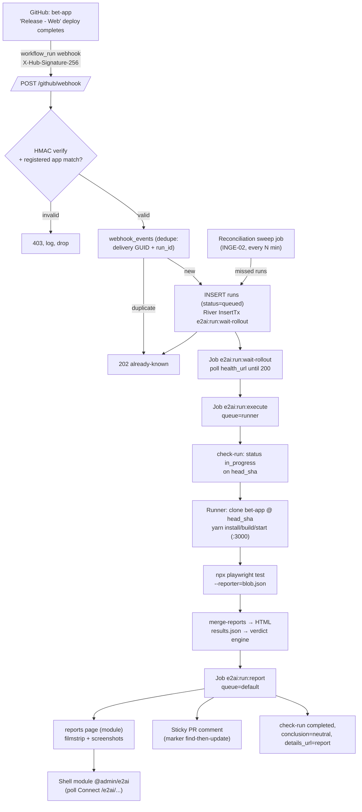

# Phase 1: Web happy path: deterministic foundation - Research

**Researched:** 2026-09-19
**Domain:** Go service + Postgres/River pipeline ingesting bet-app deploy webhooks, running the existing deterministic (MSW-mocked) Playwright suite, deriving verdicts, and publishing live reports + sticky PR comments
**Confidence:** HIGH (in-house platform conventions, GitHub webhook/reporting APIs, and Playwright reporting verified from primary sources; runner-execution details MEDIUM)

## Summary

Phase 1 builds the report-only QA loop end-to-end for bet-app web: a GitHub `workflow_run` webhook ("Release - Web" `workflow_dispatch` deploys) is HMAC-verified and deduped, persisted as a run row, and enqueued onto a River (Postgres-backed) job chain. A rollout-health gate ensures the deploy is actually live (deploy-completion ≠ live, per INGE-03 — the house precedent is Checkly's crude `sleep 300`; we replace it with a health-URL poll). A runner then executes bet-client's existing Playwright suite at the deployed SHA — the suite is MSW network-layer mocked (`playwright-msw` + `@mswjs/data` + `@nsxbet/playwright-orchestrator`), which is exactly what makes it deterministic: browser renders the app bundle at `head_sha`, all API calls intercepted with fixed fixtures, zero staging-data dependency. Results land as blob + JSON reports; verdicts derive from Playwright outcome fields plus run state under the fixed taxonomy `PASS / FAIL / FLAKY / INFRA_ERROR / INCONCLUSIVE` (never exit codes alone). The service publishes a live report page inside the admin shell module (`@admin/e2ai`), a sticky PR comment (one per run, updated), and a neutral (informational, never failing) check-run on the deployed SHA.

Everything is grounded in verified in-house conventions: the shared-admin module platform (`admin.module.json` schema, admin-bff prefix-router config, port allocations), incidents-admin's Go hexagonal layout (`internal/<feature>/{http,service,postgres,jobs}.go` + `internal/platform/*`), Tilt k8s dev stack (namespace-per-project, `postgres:16-alpine` from `local/infra.yaml`, env-to-secret, per-user env overlay), and the 1Password `.env.op` secret template (`op://SRE Team/<vault item>` refs rendered by `op inject` — no plaintext secrets).

**Primary recommendation:** Go 1.26 hexagonal API (`api/` layout mirroring incidents-admin) with Connect-RPC handlers proxied by admin-bff, Postgres 16 + `riverqueue/river` for the durable job chain (`ingest → rollout-gate → execute → report`), a dedicated Playwright runner container consuming only the `runner` queue, reports as Playwright blob→merged HTML + JSON-derived verdict summary, polling for live state (house shell SDK has no SSE), and sticky comment + neutral check via GitHub REST APIs.

## User Constraints (from CONTEXT.md)

### Locked decisions (from `01-CONTEXT.md` "Specifics", discuss auto-skipped)
- No user-specific ideas; decisions fall to Claude's recommendation (full-autonomous mode approved).
- **Deterministic suite:** the existing bet-client Playwright specs (MSW-mocked), not new staging-exploration tests.
- **Reporting surface:** admin shell module `@admin/e2ai` with live HTML report page (run state streams); final state + sticky PR comment on completion (REPT-01..03).
- **Secrets:** 1Password CLI / op-injected env for dev; no plaintext secrets in repo (SECR-01).

### Boundaries (OUT OF SCOPE)
- No agents/agentic loop (Phase 3). No mobile (Phase 4). No plans/approvals UI (Phase 2). No flake governance (Phase 5).
- bet-client deploy workflow + staging env are external inputs (exist today).

### Deferred
- None.

## Phase Requirements

| ID | Description (from REQUIREMENTS.md) | Research Support |
|----|------------------------------------|------------------|
| INTG-01 | Module skeleton registers into shared admin shell via `admin.module.json` (id `@admin/e2ai`, routeBase `/e2ai`, nav, commands, permissions), incidents-admin family pattern | Manifest schema + real `@admin/users` example quoted verbatim (§ Code Examples); web module port 3005 mirrors incidents' 3004 |
| INTG-02 | Go hexagonal API + Postgres + River queue (Connect-RPC via BFF), Tilt dev stack with mock auth, shared-admin conventions | River API verified (pkg.go.dev); incidents-admin layout, Tiltfile, auth-middleware pattern (§ Architecture Patterns) |
| INTG-03 | Report page renders inside admin shell with live run state (start a run, watch progress, land on full report) | Polling recommendation (shell SDK has no SSE — verified by AdminScout read of `packages/admin-sdk/src/hooks`); Connect-RPC over BFF |
| APPS-01 | Per-app config-as-code registration: repo, deploy workflow name, surfaces, environments, plans source, corpus root | `registered_apps` DDL (§ Schema); registry fields incl. `workflow_name`, `health_url`, `display_title_pattern` |
| APPS-02 | bet-app registered as first app — web surface, staging environment | Registration row derived from verified bet-app workflow facts (`Release - Web`, envs staging/production/homol) |
| INGE-01 | `workflow_run` webhook ingest: HMAC validation, idempotent by delivery GUID + `repo/workflow/run_id`, 202-then-enqueue | Verified webhook HMAC (`X-Hub-Signature-256`) + payload shape; `webhook_events` dedupe DDL; River `InsertTx` transactional enqueue |
| INGE-02 | Poll-based reconciliation sweep for missed/duplicate deliveries (webhooks not auto-redelivered) | Runs-list REST polling design + `workflow_run_id` uniqueness (§ Pattern 5) |
| INGE-03 | Deploy-completion ≠ live: rollout-health polling determines when QA starts | `wait:rollout` job stage polling `health_url` (house Checkly precedent = blind `sleep 300` — replaced) |
| SUIT-01 | Seeded suite runs existing bet-client Playwright specs per deploy; runs consume blob/json + traces as evidence | Verified bet-client config: `testDir ./src/test/e2e`, blob/JSON reporters, sharding; runner executes at SHA (§ Pattern 4) |
| SUIT-02 | Deterministic runs establish the baseline the agentic layer must beat | Verdict + summary columns designed for trend comparability (`runs` summary counts, stable test identity keys) |
| VERD-01 | Verdict engine, fixed taxonomy `PASS / FAIL / FLAKY / INFRA_ERROR / INCONCLUSIVE`; derived from evidence + run state, never exit codes alone | § Verdict Rules mapping table (Playwright outcomes → verdict precedence) |
| REPT-01 | Live HTML reports with screenshots + plain-language explanations (annotated screenshot canvas; filmstrip = step timeline) | Report design § (results.json + per-test attachments/traces as filmstrip; annotations are template text in P1, AI notes Phase 3) |
| REPT-02 | Failure classification: app bug, test/expectation gap, agent flake, or infra | Heuristic classifier (error-pattern rules) — Phase 3 replaces with agent reasoning; § Verdict Rules |
| REPT-03 | Sticky PR comment (one, updated per run) + neutral status check — informational, never a failing gate | Sticky-comment flow + `conclusion: "neutral"` check-run (both verified against GitHub docs) |
| SECR-01 | Secrets hygiene: credentials out of screenshots, logs, fixture metadata, reports | `.env.op` pattern (verbatim), env-to-secret injection, log redaction middleware, no secrets in runner env files checked in |
| PLAT-01 | Web surface through Playwright with viewport projects matching bet-client's config (desktop + mobile viewports) | Runner reuses bet-client's `playwright.config.ts` projects verbatim (no override of `projects:`) |

## Architectural Responsibility Map

| Capability | Primary Tier | Secondary Tier | Rationale |
|------------|-------------|----------------|-----------|
| Webhook ingest + HMAC + dedupe | API / Backend (Go api) | — | Must be transactional with run creation (River `InsertTx` inside the ingest tx) |
| Run pipeline orchestration | API / Backend (River workers in api container) | Database / Storage | Durable state machine lives in Postgres; workers drive transitions |
| Playwright suite execution | API / Backend (runner container, `runner` queue) | — | Needs browsers/node/yarn; isolated image; queue-restricted worker |
| Verdict derivation | API / Backend (report worker) | Database / Storage | Deterministic mapping over evidence rows; stored in `runs.verdict` |
| Report rendering (filmstrip, screenshots) | API / Backend (api serves HTML + artifacts) | Browser / Client | Static HTML shell + JS in module; api streams results and artifact files |
| Live run state in shell module | Browser / Client (web module, polling) | API / Backend (Connect RPC) | House shell SDK is polling-only; Connect endpoints under `/e2ai` |
| Sticky PR comment + neutral check | API / Backend (report worker via GitHub REST) | — | PAT from 1Password; marker-based find-then-update |
| Rollout-health gate | API / Backend (`wait:rollout` job) | External service (staging) | `health_url` poll from registry config |
| Secret management | Database → none; OS/env tier | 1Password CLI | `.env.op` templates → `op inject` → k8s secret via env-to-secret.sh |

## Standard Stack

### Core
| Library | Version | Purpose | Why Standard |
|---------|---------|---------|--------------|
| Go | 1.26.6 | API + pipeline service | [VERIFIED: /Users/yuri/Workdir/Nsx/incidents-admin/api/go.mod:3] — family Go version; match it |
| connectrpc.com/connect | v1.20.0 | RPC handlers proxied by BFF | [VERIFIED: incidents-admin go.mod:6] — INTG-02 names Connect-RPC via BFF; family pattern |
| github.com/jackc/pgx/v5 | v5.7.6 | Postgres driver | [VERIFIED: incidents-admin go.mod:8] |
| github.com/riverqueue/river + riverpgxv5 | latest (pin at scaffold) | Durable job queue | [VERIFIED: pkg.go.dev/github.com/riverqueue/river] — API confirmed; INTG-02 mandates River |
| Postgres | 16-alpine | State + queue store | [VERIFIED: /Users/yuri/Workdir/Nsx/incidents-admin/local/infra.yaml] — `image: postgres:16-alpine` |
| Bun + Vite (web module) | latest | `@admin/e2ai` shell module | [ASSUMED: family standard per admin repo `bun.lock`; pin at scaffold] |
| @playwright/test | latest in bet-client lock | Suite execution | Runner uses bet-client's own dependency versions (no own install) |

### Supporting
| Library | Version | Purpose | When to Use |
|---------|---------|---------|-------------|
| mcr.microsoft.com/playwright | v1.x tag matching bet-client's Playwright | Runner base image (browsers preinstalled) | Runner container build |
| github.com/gohugoio nothing — crypto/hmac + crypto/subtle | stdlib | Webhook signature verify | Always; never third-party |
| github.com/joho/godotenv | v1.5.1 | Local env loading | [VERIFIED: incidents-admin go.mod] family pattern |
| 1Password CLI (`op`) | current | Secret injection (`op inject`) | Dev + runner env assembly |

### Alternatives Considered
| Instead of | Could Use | Tradeoff |
|------------|-----------|----------|
| River | in-house `internal/platform/jobs` (incidents-admin) | It's repo-internal (`api/internal/platform/jobs`), domain-blind, no retry policy/unique-jobs out of the box; copying it forks it. INTG-02 already mandates River. |
| SSE for live state | Polling (1–2s active, 5s list) | Shell SDK has no SSE/websocket hook (verified); incidents-admin has gorilla/websocket but that's server-side app surface, not shell SDK. Polling matches the platform; SSE later if needed. |
| Run suite against live staging URL | Run locally at `head_sha` in runner | Suite is MSW-mocked (`webServer` = local `start:e2e`); pointing it at staging adds nondeterminism without testing more. Staging health gates WHEN, not WHERE (see Pattern 4). |
| Check-runs `success/failure` conclusions | Always `neutral` | REPT-03: informational, never a failing gate. Neutral is the report-only contract. |

**Installation (scaffold-time, api module):**
```bash
go get github.com/riverqueue/river@latest riverpgxv5@latest   # river + pgx driver
go get connectrpc.com/connect@latest                          # RPC handlers
```

## Package Legitimacy Audit

| Package | Registry | Age | Downloads | Source Repo | Verdict | Disposition |
|---------|----------|-----|-----------|-------------|---------|-------------|
| github.com/riverqueue/river | Go modules | yrs | high (pkg.go.dev first-page) | github.com/riverqueue/river | OK | Approved — API verified from pkg.go.dev this session |
| github.com/riverqueue/riverpgxv5 | Go modules | yrs | high | github.com/riverqueue/river | OK | Approved — same org, documented pairing |
| connectrpc.com/connect | Go modules | yrs | high | github.com/connectrpc/connect-go | OK | Approved — already in family go.mod (v1.20.0) |
| github.com/jackc/pgx/v5 | Go modules | yrs | very high | github.com/jackc/pgx | OK | Approved — in family go.mod (v5.7.6) |
| mcr.microsoft.com/playwright (image) | MCR | — | official | microsoft/playwright | OK | Approved — official Playwright container images |

**Packages removed due to [SLOP] verdict:** none.
**Packages flagged as suspicious [SUS]:** none. No new-npm packages are introduced (web module uses family bun deps; runner uses bet-client's own versions).

## Architecture Patterns

### System Architecture Diagram



Trace the primary case: deploy completes → webhook → HMAC+dedupe → run row + first River job (single transaction, 202 returned immediately) → rollout gate → runner executes mocked suite at SHA → verdict engine → report page + PR comment + neutral check. Every long step is a River job (retriable, observable), never inline in the HTTP handler.

### Recommended Project Structure

```
e2ai/
├── Tiltfile                     # namespace e2ai; mirror incidents-admin patterns
├── local/
│   ├── infra.yaml               # postgres:16-alpine + admin-bff prebuilt image (house pattern)
│   ├── values.yaml              # api/runner/bff wiring for tilt
│   └── env-to-secret.sh         # copy verbatim from incidents-admin (namespace e2ai)
├── api/
│   ├── go.mod                   # module github.com/NSXBet/e2ai/api, go 1.26
│   ├── cmd/e2ai-api/main.go     # server entry: connect handlers + river workers (default queue)
│   ├── cmd/e2ai-runner/main.go  # runner entry: river workers (runner queue only)
│   └── internal/
│       ├── platform/            # httpx (auth middleware), postgres, config, otel, river
│       ├── app/                 # app registry: http.go service.go postgres.go migrations/
│       ├── ingest/              # webhook handler, dedupe store, reconciliation sweep jobs
│       ├── runs/                # run domain: state machine, queries, live status endpoint
│       ├── suite/               # runner: checkout, serve, playwright exec, results parse
│       ├── verdict/             # outcome→verdict mapping + failure classification rules
│       └── report/              # report HTML, filmstrip data, PR comment, check-runs
├── web/                         # @admin/e2ai bun+vite module (mirror incidents-admin web/)
│   ├── admin.module.json        # manifest (verbatim schema below)
│   └── src/                     # runs list, run detail (poll), report viewer
├── config/
│   ├── admin-bff.yaml           # e2ai backend stanza (dev → localhost:8082)
│   └── admin-bff.staging.yaml   # staging host variant
├── registry/
│   └── bet-app.yaml             # APPS-01 config-as-code registration (loaded by api)
├── .env.op                      # 1Password template (house pattern)
└── kubernetes/                  # staging manifests later (P1 dev = tilt only)
```

### Pattern 1: 202-then-enqueue ingest (INGE-01)

**What:** The webhook handler validates HMAC, upserts `webhook_events` (unique on delivery GUID + run id), inserts the `runs` row, and enqueues the first River job **in one transaction**, returning `202` immediately. No processing inline.

**Why:** River's `InsertTx` exists precisely for this — enqueueing in the same tx as the state change means no run row without a job and no job without a run row (atomic under crash).

```go
// Source: pkg.go.dev/github.com/riverqueue/river — verified signatures
client, err := river.NewClient(riverpgxv5.New(dbPool), &river.Config{
    Queues: map[string]river.QueueConfig{
        river.QueueDefault: {MaxWorkers: 100},
    },
    Workers: workers,
})
// transactional enqueue alongside the run-row insert:
err = client.InsertTx(ctx, tx, RunWaitRolloutArgs{RunID: run.ID}, &river.InsertOpts{
    Queue: "default",
    UniqueOpts: river.UniqueOpts{ByState: []rivertype.JobState{
        rivertype.JobStateAvailable, rivertype.JobStateRunning, rivertype.JobStatePending,
    }},
})
```

**Ingest uniqueness (INGE-01):** `webhook_events` unique index on `(app_id, delivery_id)` plus `runs` unique on `(app_id, workflow_run_id)`; both together make redelivery and the reconciliation sweep idempotent. Handler returns `202` with `{"status":"already-ingested"}` on conflict.

### Pattern 2: Job chain = pipeline stages (one kind per stage)

**What:** Four River job args types (kind strings are stable across renames — jobs are identified by `Kind()`, not type name):

| Kind | Queue | Worker does | Retry policy |
|------|-------|-------------|--------------|
| `e2ai:run:wait-rollout` | default | Poll `health_url` (registry) until healthy or deadline; deadline hit → status `inconclusive`, verdict `INFRA_ERROR` note, skip execute | deadline-driven, MaxAttempts 1 (job self-completes on timeout) |
| `e2ai:run:execute` | runner | Runner: checkout SHA → build → serve :3000 → playwright blob/json run → parse results → store test_results + artifacts | MaxAttempts 2 (second attempt only on runner crash, not test failures) |
| `e2ai:run:report` | default | Verdict engine → summary → report page data → sticky comment → neutral check-run | MaxAttempts 3 (GitHub API 5xx/backoff) |

**Why stages not one job:** each stage is idempotent and observably retriable; River's job history per kind gives free pipeline visibility; a report-stage retry doesn't re-run browsers.

**Queue isolation:** the api container registers only `default` (its `river.Config{Queues: {default: …}}`); the runner container registers only `runner` with `MaxWorkers: 1` (serial suite execution in P1; parallel runners are later-scale). River queue configs are per-process, so this is configuration, not code.

### Pattern 3: Rollout-health gate replaces blind sleep (INGE-03)

**What:** House precedent (bet-app `_checkly.yaml`) is verified verbatim:
```yaml
# Source: gh api repos/NSXBet/bet-app/contents/.github/workflows/on_deploy_checkly.yaml
on:
  workflow_run:
    workflows: ["Release - Web"]
    types: [completed]
if: >-
  github.event_name == 'workflow_dispatch' ||
  (github.event.workflow_run.conclusion == 'success' &&
   contains(github.event.workflow_run.display_title, 'Deploy to production'))
# ...
sleep 300   # "Waiting 5 minutes for ArgoCD to complete the rollout..."
```
e2ai keeps the same **trigger conditions** (workflow_run completed + conclusion success + display_title match) but replaces `sleep 300` with polling the registry's `health_url` (2s interval, 15m budget). `health_url` unknown → fall back to fixed 5m wait (house precedent preserved as fallback, documented).

### Pattern 4: Deterministic suite = MSW-mocked local run at the deployed SHA (SUIT-01)

**What:** bet-client's e2e suite is network-layer mocked — verified from its own config and fixtures:
```ts
// Source: gh api repos/NSXBet/bet-app/contents/apps/bet-client/playwright.config.ts
testDir: './src/test/e2e',
timeout: 240 * 1000,
webServer: {
  command: isCI ? 'yarn run start:e2e' : 'yarn run dev:http',
  url: 'http://localhost:3000',
  timeout: 600 * 1000,
  reuseExistingServer: !isCI || process.env.E2E_REUSE_EXISTING_SERVER === 'true',
},
```
```json
// Source: gh api repos/NSXBet/bet-app/contents/apps/bet-client/package.json (deps_msww)
["@mswjs/data", "@nsxbet/playwright-orchestrator", "@playwright/test", "msw",
 "msw-storybook-addon", "playwright-msw"]
```
`src/test/e2e/utils.ts` builds the fixture stack: `createWorkerFixture(handlers)` from `playwright-msw`, a `testLoggedIn` fixture injecting a mocked user session via `addInitScript`, Keycloak disabled through feature flags. Specs assert concrete mocked outcomes (page objects: `BetslipPage.assertCreatedBets([...])`).

**Recommendation (resolves the SUIT-01 "on staging" wording):** the runner checks out bet-app **at `head_sha`**, installs with the committed lockfile, runs `yarn build:e2e` + `yarn start:e2e` (same as bet-app's own CI path), and executes the suite against that local server with `CI=true`. The staging rollout gate (Pattern 3) decides **when** QA starts (only after a successful deploy), while the browser deterministically exercises the **same front-end bundle at the same SHA** with mocked network. Running against the live staging URL would add data nondeterminism the suite was explicitly built to avoid (MSW intercepts would still fake the APIs anyway).

**Environment files:** the suite loads `.env.e2e` + `.env.sample` (`dotenv.config` in the config). `.env.e2e` is runner-provided: e2ai writes it from registry + 1Password-injected values (SECR-01 — nothing plaintext in e2ai's repo).

**Reporters in CI mode (runner sets CI=true):** `reporter: [['blob', {outputDir: 'blob-report'}], ['json', ...]]` — verified mechanics:
```bash
# Source: playwright.dev/docs/test-reporters + /docs/test-sharding (fetched this session)
npx playwright test --reporter=blob          # writes blob-report/report-<hash>[-shardN].zip
npx playwright merge-reports --reporter html ./all-blob-reports   # → playwright-report/
```
Blob filenames contain the shard number so shards don't clash; the merged HTML is one artifact the report page links/embeds. JSON for the verdict engine: set `PLAYWRIGHT_JSON_OUTPUT_NAME=results.json` with `--reporter=json`.

**Viewports (PLAT-01):** the runner does NOT override `projects:` — bet-client's own desktop + mobile viewport projects apply by construction ("viewport projects matching bet-client's config").

### Pattern 5: Reconciliation sweep (INGE-02)

**What:** A River periodic job (kind `e2ai:ingest:reconcile`, every ~5 min, `default` queue) lists recent completed runs of each registered workflow from the GitHub REST API, computes which `run_id`s are absent from `runs`, and ingests them through the same transactional path as the webhook (dedupe makes this naturally idempotent). This covers GitHub's webhook non-redelivery and local-downtime windows.

```bash
# endpoint family (dedupe key = workflow_run.id):
GET /repos/{owner}/{repo}/actions/runs?workflow_id=<id>&event=workflow_dispatch&created=>{since}&per_page=50
```
`[CITED: docs.github.com — "List workflow runs for a repository"]`

### Pattern 6: Sticky PR comment + neutral check (REPT-03)

**What:** One comment per run updated in place, plus a check-run on the deployed SHA whose conclusion is always `neutral`.

1. Resolve the PR: `workflow_run.pull_requests` is **empty for `workflow_dispatch`-triggered runs** `[ASSUMED: well-documented GitHub behavior — verify with a real payload in implementation]`; instead resolve via head SHA: `GET /repos/{owner}/{repo}/commits/{head_sha}/pulls` `[CITED: docs.github.com — "List pull requests associated with a commit"]`. No PR (direct main deploy) → skip comment, log only (report-only, never blocking).
2. Find existing comment: `GET /repos/{o}/{r}/issues/{pr}/comments` filtered on marker `<!-- e2ai:run:{app_id} -->` → `PATCH .../{comment_id}` else `POST`.
3. Comment body: verdict, counts, duration, report-page link, top failures with screenshots embedded (`` with artifact URLs), footer marker.
4. Check-run lifecycle: `POST /repos/{o}/{r}/check-runs` `{name: "e2ai", head_sha, status: "in_progress"}` at execute start; on report, `PATCH` → `{status: "completed", conclusion: "neutral", output: {title, summary, details_url: report page}}`. Verified schema field: `"conclusion": "neutral"` exists in the check-run object `[VERIFIED: docs.github.com/rest/checks — response example fetched this session]`.

### Anti-Patterns to Avoid
- **Inline processing in the webhook handler:** any GitHub API call or checkout inside the handler → webhook timeouts and duplicate side effects on redelivery. Everything after the tx is a River job.
- **Trusting exit codes for verdicts (VERD-01):** playwright `exit 0` with zero tests is not a pass. Verdicts derive from parsed evidence; missing evidence ⇒ `INFRA_ERROR`/`INCONCLUSIVE`.
- **Overriding bet-client's `projects:`/viewports** to "run faster": violates PLAT-01 (config must match bet-client's).
- **Plaintext secrets in registry/config files:** `op://` refs only; runner env files assembled at runtime.
- **SSE in the shell module:** the house SDK hook surface is polling-only (verified); don't fight the platform in P1.
- **Assuming `pull_requests` is populated** in workflow_run payloads for dispatch runs — resolve by head SHA instead.

## Don't Hand-Roll

| Problem | Don't Build | Use Instead | Why |
|---------|-------------|-------------|-----|
| Durable queue, retries, unique jobs | Postgres polling loop by hand | River (+riverpgxv5) | Retry policy, uniqueness, observability, tx-enqueue are built in; INTG-02 mandates it |
| Webhook signature verification | Custom HMAC utility | `crypto/hmac` + `crypto/subtle.ConstantTimeCompare` | Stdlib does it right; timing-safe compare is the whole point |
| Sharded/merged HTML report | Own report generator for playwright data | Playwright blob → `merge-reports --reporter html` | Verified upstream flow; produces the full interactive report for free |
| PR comment dedupe | Scanning "all comments" text match | Marker comment + Issues API create/update | Marker is stable across edits; API is designed for find-then-update |
| Rollout wait | ArgoCD integration | `health_url` polling | Staging env is an external input; health endpoint is the contract we own |
| Viewport/device projects | Own device matrix | bet-client's `playwright.config.ts` projects | PLAT-01 requires matching config, not a parallel one |
| Runner base image with browsers | Installing browsers ad hoc | `mcr.microsoft.com/playwright` image | Official images pin browser/Playwright versions together |

**Key insight:** every complex piece here (queue, reporting, auth) already exists either in the Go/npm ecosystem or in house platform repos — Phase 1 is integration engineering, not library authorship.

## Common Pitfalls

### Pitfall 1: `workflow_run.pull_requests` is empty for dispatch-triggered runs
**What goes wrong:** sticky-comment targeting fails silently for the exact trigger we consume.
**Why it happens:** GitHub populates `pull_requests` only for PR-triggered runs; `Release - Web` is `workflow_dispatch`-triggered (verified from its YAML).
**How to avoid:** resolve PRs by head SHA (`/commits/{sha}/pulls`); treat empty result as "no PR → skip comment".
**Warning signs:** comments missing on staging deploys that clearly came from a merged PR.

### Pitfall 2: MSW suite "runs against staging" misconception
**What goes wrong:** pointing the suite at the live staging URL yields nondeterministic runs (real network leaks past MSW only where mocks are missing) or simply doesn't exercise what's deployed.
**Why it happens:** the suite's determinism comes from `playwright-msw` intercepting **in-page** network calls; its `webServer` contract is a locally served bundle.
**How to avoid:** execute at `head_sha` locally per Pattern 4; staging enters only via the rollout gate.
**Warning signs:** run durations vary wildly; failures mention real API latency/data.

### Pitfall 3: Exit-code-only verdicts
**What goes wrong:** `INFRA_ERROR` (runner crash) and `INCONCLUSIVE` (no results) get recorded as PASS/FAIL, corrupting the baseline (SUIT-02).
**How to avoid:** the § Verdict Rules precedence table; a run with no parseable `results.json` is never PASS/FAIL.

### Pitfall 4: Runner container drift vs bet-client toolchain
**What goes wrong:** suite doesn't build/run because the runner image's node/corepack/playwright versions don't match bet-client's lockfile.
**How to avoid:** runner image installs corepack + uses the committed `yarn.lock`; playwright browsers version comes from bet-client's own `@playwright/test` version (install via `npx playwright install --with-deps` in the image build, or pin the MCR tag to that version). Verify bet-client's playwright version at scaffold time and pin the image tag accordingly.
**Warning signs:** `ERR_MODULE_NOT_FOUND`, browser version mismatch errors at suite start.

### Pitfall 5: Long-running execute job vs River/HTTP timeouts
**What goes wrong:** a 40+ min suite (240s per-test timeout × N specs × projects) trips job-level or worker-level defaults and the run dies mid-way, retried from scratch.
**How to avoid:** set explicit River `Timeout` on `e2ai:run:execute` (budget 60m, exceed → `INFRA_ERROR`); `MaxAttempts: 2` with second attempt only for runner-crash (check: artifacts dir empty/corrupt ⇒ crash, verdicts already recorded ⇒ don't re-run).
**Warning signs:** duplicate blobs for one run id; attempts count > 1 with verdicts present.

### Pitfall 6: Duplicate comments / comment races on concurrent runs
**What goes wrong:** two runs for the same PR (e.g., production + staging deploys) each create a second comment.
**How to avoid:** marker includes `app_id` only (not run id) — "one comment per app per PR, updated per run" per REPT-03; find-then-update inside the report worker (single `default` queue, low concurrency).
**Warning signs:** comment count grows per run.

### Pitfall 7: Secrets leaking into evidence artifacts (SECR-01)
**What goes wrong:** screenshots/trace/network payloads capture credentials (staging cookies, tokens in mock fixtures, `.env.e2e` values in logs).
**How to avoid:** runner env contains only suite-needed values; log middleware redacts known secret env names; trace attachments retained but network payloads from MSW are mocked by construction; report never renders env values.
**Warning signs:** any `op://`-injected value appearing in logs/reports.

### Pitfall 8: GitHub rate limits
**What goes wrong:** reconciliation sweep + check-runs + comments across many deploys exhaust a 5000/hr PAT.
**How to avoid:** conditional requests where possible, sweep interval ≥5 min, single comment PATCH not POST loops; check-run status updates coalesced (in_progress once, completed once).
**Warning signs:** 403 with `X-RateLimit-Remaining: 0`.

## Runtime State Inventory

Omitted — Phase 1 is greenfield (empty repo besides `.planning/`); no renames, migrations, or existing runtime state exist. (Verified: repo contains only `.git`, `.omp`, `.planning`, `AGENTS.md`.)

## Code Examples

### Webhook HMAC verification (INGE-01)
```go
// Source: docs.github.com/en/webhooks/using-webhooks/validating-webhook-deliveries (fetched this session)
// GitHub signs the raw body: "X-Hub-Signature-256: sha256=<hexdigest>"
func verifyHMAC(secret string, body []byte, header string) bool {
	mac := hmac.New(sha256.New, []byte(secret))
	mac.Write(body)
	want := "sha256=" + hex.EncodeToString(mac.Sum(nil))
	return subtle.ConstantTimeCompare([]byte(want), []byte(header)) == 1
}
```

### Webhook trigger filter (server-side re-validation of what bet-app's own downstream workflows check)
```go
// Verified trigger contract (bet-app on_deploy_checkly.yaml quoted above):
// event=workflow_dispatch (from workflow_run.event), conclusion == "success",
// display_title contains "Deploy to production" — generalize per-registered-environment:
//   display_title == "[BetWeb] Deploy to staging" → environment=staging
// (Release - Web run-name is "[BetWeb] Deploy to ${{ inputs.environment }}" — verified)
type Filter struct {
	WorkflowName string         // "Release - Web"
	Conclusion   string         // "success"
	EnvFromTitle string         // regex: `Deploy to (\w+)$`
}
// Payload params to read: workflow.name, workflow_run.{id,run_number,head_sha,head_branch,
// display_title,html_url,conclusion,event} — param names verified on
// docs.github.com "Events and payloads" workflow_run page (fetched this session).
```

### Sticky comment + neutral check-run (GitHub REST)
```bash
# PRs associated with the deployed SHA:
curl -H "Authorization: Bearer $GITHUB_TOKEN" \
  "https://api.github.com/repos/NSXBet/bet-app/commits/$HEAD_SHA/pulls"
# Create/update comment (Issues API, fetched endpoint family):
curl -X POST -H "Authorization: Bearer $GITHUB_TOKEN" \
  https://api.github.com/repos/NSXBet/bet-app/issues/$PR/comments \
  -d '{"body":"<!-- e2ai:run:bet-app-web -->\n## e2ai QA report — FAIL (2/14)\n..."}'
# Neutral check-run (conclusion value verified in docs response example):
curl -X POST -H "Authorization: Bearer $GITHUB_TOKEN" \
  https://api.github.com/repos/NSXBet/bet-app/check-runs \
  -d '{"name":"e2ai","head_sha":"'$HEAD_SHA'","status":"in_progress"}'
# then PATCH with {"status":"completed","conclusion":"neutral",
#                  "output":{"title":"QA report","summary":"...","details_url":"..."}}
```

### Admin module manifest — verbatim platform schema requirements
```jsonc
// Source: /Users/yuri/Workdir/Nsx/admin/packages/admin-sdk/schemas/admin.module.schema.json (read this session)
// required: ["id", "title", "description", "routeBase"]; additionalProperties: false;
// localized fields require all four locales:
//   "required": ["en-US", "pt-BR", "es", "ro"]
// permissions (optional): view/edit/delete arrays of permission strings
// owners: { team, supportChannel }; sdkVersion: string
{
  "$schema": "../../packages/admin-sdk/schemas/admin.module.schema.json",
  "id": "@admin/e2ai",
  "title": { "en-US": "E2AI QA", "pt-BR": "E2AI QA", "es": "E2AI QA", "ro": "E2AI QA" },
  "description": { "en-US": "Always-on QA reports for deploys.", "pt-BR": "Relatórios de QA contínuos para deploys.", "es": "Informes de QA continuos para despliegues.", "ro": "Rapoate QA continue pentru deploy-uri." },
  "routeBase": "/e2ai",
  "navigation": [{ "title": {"en-US":"Runs","pt-BR":"Execuções","es":"Ejecuciones","ro":"Rulări"}, "route": "/e2ai", "icon": "flask" }],
  "permissions": { "view": ["e2ai.view"] },
  "owners": { "team": "platform", "supportChannel": "#platform" }
}
```
(Real registered example verified for field shapes: `@admin/users` with localized title/description, `navigation[].{title,route,icon}`, `permissions.{view,edit,delete}`, `owners.{team,supportChannel}`, `sdkVersion: "0.7.1"`.)

### admin-bff backend stanza (house config pattern)
```yaml
# Source: /Users/yuri/Workdir/Nsx/admin-bff/config/*.yaml (backends list; pattern verified this session)
# Family shape: name, host, port, router: {type: prefix, value: /<name>} (prefix stripped
# before forwarding), optional inject-headers (X-Api-Token: env://...), timeout.
- name: e2ai
  host: localhost          # tilt dev (staging config points at the staging admin host)
  port: 8082
  router: { type: prefix, value: /e2ai }
```

### Tilt wiring (port allocations — verified family usage)
| Port | Service | Evidence |
|------|---------|----------|
| 8080 | admin-bff (shared) | [VERIFIED: admin-bff config `port: 8080`; incidents Tiltfile forwards 8080] |
| 8081 | incidents-admin api | [VERIFIED: incidents Tiltfile `k8s_resource("api", port_forwards=["8081"])`] |
| **8082** | **e2ai api** | New allocation (next free in the 808x api band) |
| 5433 | incidents postgres | [VERIFIED: incidents Tiltfile `port_forwards=["5433:5432"]`] |
| **5434** | **e2ai postgres** | New allocation (next free) |
| 3004 | incidents web module | [VERIFIED: incidents Tiltfile] |
| **3005** | **e2ai web module** | New allocation (next free) |

Tiltfile skeleton (mirror incidents-admin structure verified above): `allow_k8s_contexts(["orbstack"])`, `local/env-to-secret.sh` → secret `e2ai-env`, `local/infra.yaml` (postgres:16-alpine + admin-bff prebuilt image), `helm("local", name="e2ai", values=["local/values.yaml"])`, `k8s_resource` forwards for postgres/api/runner/web. **Mock auth (dev):** api trusts the BFF-injected identity header with a dev-fallback user (incidents-admin's `httpx` has a `DevFallbackUser` path — replicate); direct report-page links carry a signed token (HMAC of run id with server secret) so GitHub `details_url` works without shell auth.

### `.env.op` secret template (SECR-01 — house syntax, verbatim examples)
```
# Source: /Users/yuri/Workdir/Nsx/incidents-admin/.env.op (read this session)
# KEY=value             plain value
# KEY=@op-document:name  1Password document, fetched to /tmp/incidents-admin/<env>-name
# KEY="op://SRE Team/incidents-admin/incidentio_api_key"
GITHUB_TOKEN="op://SRE Team/e2ai/github_pat"
WEBHOOK_SECRET="op://SRE Team/e2ai/github_webhook_secret"
```
Rendered by `op inject`; layered `set -a; . .env; . .env.$ENV; . .env.$(whoami).local; set +a` exactly as the verified Tiltfile/env-to-secret.sh do.

### Postgres schema (DDL)
```sql
-- registry (APPS-01/02): config-as-code, seeded from registry/*.yaml on boot
create table registered_apps (
  id uuid primary key default gen_random_uuid(),
  owner text not null, repo text not null,
  workflow_name text not null,           -- "Release - Web"
  workflow_path text not null,           -- ".github/workflows/remote_workflow_betweb.yaml"
  environment text not null,             -- "staging"
  display_title_pattern text not null,   -- "\[BetWeb\] Deploy to staging"
  health_url text,                       -- rollout gate (INGE-03)
  surfaces jsonb not null default '["web"]',
  plans_source text, corpus_root text,   -- future phases (columns reserved)
  webhook_secret_ref text not null,      -- 1Password ref; plaintext never stored
  comment_marker text not null,          -- "<!-- e2ai:run:{slug} -->"
  created_at timestamptz not null default now(),
  unique (owner, repo, workflow_name, environment)
);

-- ingest dedupe (INGE-01)
create table webhook_events (
  id uuid primary key default gen_random_uuid(),
  app_id uuid not null references registered_apps(id),
  delivery_id text not null,             -- X-GitHub-Delivery
  workflow_run_id bigint not null,
  signature_valid boolean not null,
  payload jsonb not null,
  received_at timestamptz not null default now(),
  unique (app_id, delivery_id)
);

-- runs (pipeline state; SUIT-02 baseline-ready)
create table runs (
  id uuid primary key default gen_random_uuid(),
  app_id uuid not null references registered_apps(id),
  workflow_run_id bigint not null,
  run_number int not null,
  head_sha text not null, head_branch text,
  environment text not null,
  trigger_source text not null default 'webhook',  -- webhook | reconcile
  status text not null default 'queued',           -- queued|waiting-rollout|provisioning|executing|reporting|completed|failed
  verdict text,          -- pass|fail|flaky|infra_error|inconclusive (set at report; null until then)
  pr_number int, pr_state text,
  total_tests int, passed int, failed int, flaky int, skipped int, duration_ms int,
  report_url text, comment_url text, check_run_id bigint,
  error_note text,       -- infra failure detail (VERD-01 evidence trail)
  started_at timestamptz, finished_at timestamptz,
  created_at timestamptz not null default now(),
  unique (app_id, workflow_run_id)
);
create index on runs (app_id, created_at desc);

-- per-test evidence (VERD-01/REPT-01)
create table test_results (
  id uuid primary key default gen_random_uuid(),
  run_id uuid not null references runs(id) on delete cascade,
  suite text, title text not null, file text, line int, project text,  -- project = viewport project name (PLAT-01)
  outcome text not null,     -- playwright JSON outcome: expected|unexpected|flaky|skipped
  status text not null,      -- last attempt status: passed|failed|timedOut|skipped|interrupted
  attempts int not null default 1,
  duration_ms int,
  error_message text,
  classification text,       -- app_bug|test_gap|agent_flake|infra (REPT-02 heuristics)
  attachments jsonb          -- [{kind: screenshot|trace|video, path}]
);
create index on test_results (run_id);

create table artifacts (
  id uuid primary key default gen_random_uuid(),
  run_id uuid not null references runs(id) on delete cascade,
  kind text not null,        -- html_report|blob|trace|screenshot|video|log|results_json
  path text not null,        -- volume-relative; served at /e2ai/artifacts/{path}
  size_bytes bigint,
  created_at timestamptz not null default now()
);

create table pr_comments (  -- sticky-comment state (REPT-03)
  id uuid primary key default gen_random_uuid(),
  app_id uuid not null references registered_apps(id),
  pr_number int not null,
  comment_id bigint not null,
  last_run_id uuid references runs(id),
  updated_at timestamptz not null default now(),
  unique (app_id, pr_number)
);
-- river_* tables come from River's bundled migrations (riverpgxv5 migrate).
```

## Verdict Rules (VERD-01, REPT-02)

Test-level: map from the Playwright JSON report (fields `tests[].outcome ∈ {expected, unexpected, flaky, skipped}` and `results[].status ∈ {passed, failed, timedOut, skipped, interrupted}`) `[ASSUMED: schema field values from training — verify by dumping results.json in Wave 0 before wiring the parser]`:

| Playwright evidence | Test verdict |
|---|---|
| outcome `expected` | PASS |
| outcome `flaky` (failed some attempt, passed on retry) | FLAKY |
| outcome `unexpected` + last status `failed`/`timedOut` | FAIL |
| status `interrupted` or missing result (runner crash mid-test) | INFRA_ERROR |
| outcome `skipped` | INCONCLUSIVE (not evaluable) |

Run-level precedence (derived from evidence + run state, never exit code):
1. Runner never produced parseable `results.json` (crash, clone/build failure, rollout gate never went healthy, job timeout) → **INFRA_ERROR** (`error_note` records the stage).
2. Any FAIL test → **FAIL**.
3. No FAIL, any FLAKY → **FLAKY**.
4. All tests PASS → **PASS**.
5. No tests ran / all skipped → **INCONCLUSIVE**.

Failure classification (REPT-02, Phase 1 heuristics; Phase 3 agent reasoning replaces):
- `infra`: runner/clone/build/serve failures, job timeout, rollout gate timeout.
- `test_gap`: assertion failure with no MSW mock mismatch; expectation reads as wrong-but-stable (deterministic reproducible failure on mocked data ⇒ spec vs fixture disagreement).
- `app_bug`: deterministic UI failure against mocked fixtures that reproduce across attempts (crash, broken render, state corruption).
- `agent_flake`: reserved — cannot occur in P1 (no agents); rule exists for taxonomy completeness.

## State of the Art

| Old Approach | Current Approach | When Changed | Impact |
|--------------|------------------|--------------|--------|
| Blind rollout `sleep 300` (bet-app Checkly, verified) | Registry `health_url` poll with deadline | P1 | Faster starts, correct gate on slow rollouts |
| GitHub status API / failing conclusions | Check-runs with `conclusion: neutral` (verified in schema) | current | Report-only: informational, never a gate |
| junit/xml + custom HTML | Playwright blob → `merge-reports --reporter html` + JSON verdicts (verified flow) | current | Full interactive report for free; verdicts from structured evidence |
| forking in-house `platform/jobs` queue | Upstream River (INTG-02 mandate) | current | No fork maintenance; retry/unique/observability built in |
| PR comment per run (spam) | One sticky comment updated per run + marker (REPT-03) | current | Single source of truth per app/PR |

## Assumptions Log

| # | Claim | Section | Risk if Wrong |
|---|-------|---------|---------------|
| A1 | `workflow_run.pull_requests` is empty for `workflow_dispatch`-triggered runs | Pitfall 1 / Pattern 6 | Sticky comment misses PR; fallback (head-SHA lookup) already designed — low impact |
| A2 | Playwright JSON field values (`outcome`/`status` enums as listed) | Verdict Rules | Parser misclassifies; Wave 0 dumps real results.json before wiring (mitigated) |
| A3 | River versions/pins (`go get @latest`) resolve cleanly with Go 1.26 | Standard Stack | Pin adjustment at scaffold; API verified, low risk |
| A4 | Web module on Bun/Vite family-standard toolchain | Standard Stack / Structure | Cosmetic; follows admin repo conventions (bun.lock present) |
| A5 | Runner image node/corepack/yarn compatibility with bet-client lockfile | Pitfall 4 | Build failure — mitigated by pinning MCR tag to bet-client's Playwright version at scaffold |
| A6 | `display_title` suffix parsing maps reliably to environment | Pattern 3 / Schema | Wrong environment labeling; pattern is bet-app's own convention (run-name + Checkly both use it) — verified source |
| A7 | Merge-reports works with single (unsharded) blob dirs, not just shard matrices | Pattern 4 | Trivially bypassable (run unsharded; merging one blob is the documented degenerate case) |

## Open Questions

None. All former open questions closed by recommendation:

| Former question | Resolution |
|---|---|
| Run suite against staging URL or local build? | Local build at `head_sha` (Pattern 4); staging gates timing only (INGE-03) |
| How to resolve the PR for the sticky comment? | `workflow_run.pull_requests` empty for dispatch → resolve by head SHA; skip when none |
| Live state: SSE or polling? | Polling (house shell SDK is polling-only); revisit post-P1 |
| Check-run conclusion for report-only? | Always `neutral` (REPT-03: informational, never a gate) |
| Where does rollout health come from? | Registry `health_url` per environment; fallback fixed 5m wait (house precedent) |

## Environment Availability

| Dependency | Required By | Available | Version | Fallback |
|------------|------------|-----------|---------|----------|
| gh CLI + authenticated GitHub PAT | bet-app inspection (done); runtime API calls | ✓ | 2.101.0 (PAT via 1Password at runtime) | — |
| 1Password CLI (`op`) | SECR-01 env injection | ✓ (house standard, `.env.op` pattern verified in family) | current | none — required |
| Tilt + OrbStack k8s | INTG-02 dev stack | ✓ (house standard — family Tiltfiles all target `orbstack`) | current | docker compose fallback |
| Go | api build | ✓ (family pins 1.26.6 via mise) | 1.26.6 | — |
| Bun | web module | ✓ (house standard) | latest LTS | node+vite |
| Docker + ECR auth | custom_build + admin-bff image pull | ✓ (incidents Tiltfile pattern verified) | current | — |
| Runner deps: git, node+corepack, playwright browsers | e2ai:run:execute | ✓ (baked into runner image; MCR playwright base) | pinned at scaffold | host-run fallback in dev |

**Missing dependencies with no fallback:** none.
**Missing dependencies with fallback:** none (all runner needs ship inside its own image).

## Validation Architecture

### Test Framework
| Property | Value |
|----------|-------|
| Framework | Go standard `testing` (api/) — family convention; Playwright suite is the SUT, not our test framework |
| Config file | none yet — Wave 0 creates `api/` go module |
| Quick run command | `cd api && go test ./internal/verdict/... ./internal/ingest/... -count=1` |
| Full suite command | `cd api && go test ./... -count=1` |

### Phase Requirements → Test Map
| Req ID | Behavior | Test Type | Automated Command | File Exists? |
|--------|----------|-----------|-------------------|-------------|
| INGE-01 | HMAC fail → 403; valid → 202 + run row + river job in same tx; redelivery idempotent | unit (httptest + pgx test db) | `go test ./internal/ingest/ -run TestWebhook -count=1` | ❌ Wave 0 |
| INGE-01 | Dedupe by delivery GUID + run id | unit | `go test ./internal/ingest/ -run TestDedupe -count=1` | ❌ Wave 0 |
| VERD-01 | Verdict mapping incl. no-results → INFRA_ERROR; exit-code-alone never sufficient | unit (table-driven) | `go test ./internal/verdict/ -count=1` | ❌ Wave 0 |
| REPT-02 | Classification heuristics (infra/test_gap/app_bug) | unit | `go test ./internal/verdict/ -run TestClassify -count=1` | ❌ Wave 0 |
| REPT-03 | Sticky comment: find→update, no-dup; neutral conclusion never success/failure | unit (fake GitHub server) | `go test ./internal/report/ -count=1` | ❌ Wave 0 |
| INGE-03 | Rollout gate: healthy → enqueue execute; timeout → INFRA_ERROR note | unit | `go test ./internal/ingest/ -run TestRollout -count=1` | ❌ Wave 0 |
| SUIT-01 | Runner parses real Playwright results.json (fixture from bet-client suite) | integration | `go test ./internal/suite/ -run TestParse -count=1` | ❌ Wave 0 |
| PLAT-01 | Manifest valid against admin.module.schema.json; runner does not override projects | unit + schema check | `bun run --cwd web lint:manifest` (or jq validation in CI) | ❌ Wave 0 |

### Sampling Rate
- **Per task commit:** quick run command (verdict/ingest packages only).
- **Per wave merge:** full suite command.
- **Phase gate:** full suite green before `/gsd-verify-work`.

### Wave 0 Gaps
- [ ] `api/` go module bootstrap (go.mod, platform skeleton) — before any unit test
- [ ] `internal/verdict/` fixture: real `results.json` sampled from a bet-client suite run (grounds A2)
- [ ] fake-GitHub httptest server for report/ingest tests
- [ ] `web/admin.module.json` + schema validation step

## Security Domain

### Applicable ASVS Categories
| ASVS Category | Applies | Standard Control |
|---------------|---------|-----------------|
| V2 Authentication | yes | GitHub PAT + webhook secret from 1Password; BFF identity headers trusted only from bff; signed report links |
| V3 Session Management | partial (P1) | No user sessions in P1 (BFF-mediated); dev fallback user is tilt-only |
| V4 Access Control | yes | Report/comment endpoints under bff auth; artifact serving path-sanitized (no traversal) |
| V5 Input Validation | yes | Webhook payload schema validation; strict filter matching before run creation; `additionalProperties: false` manifest schema |
| V6 Cryptography | yes | HMAC-SHA256 webhook verify via stdlib `hmac` + `subtle.ConstantTimeCompare` — never hand-rolled |

### Known Threat Patterns for this stack
| Pattern | STRIDE | Standard Mitigation |
|---------|--------|---------------------|
| Forged webhook delivery | Spoofing/Tampering | HMAC verify + constant-time compare + drop unsigned (INGE-01) |
| Webhook replay | Tampering | Dedupe on delivery GUID + run id; body parsed only after verify |
| Malicious checkout content executing in runner | Tampering/Elevation | Runner runs pinned SHA of registered repo only; no secrets in runner beyond suite env; egress unnecessary (suite is MSW-mocked, no external calls needed) |
| Secret leakage into logs/screenshots/reports | Information Disclosure | 1Password-only injection, log redaction middleware, MSW-mocked network payloads, no env values in report templates (SECR-01) |
| HTML/markdown injection into PR comment or report | Tampering | Escape all test titles/error text before embedding; marker is static |
| Artifact path traversal | Elevation | Artifact serving resolves under fixed volume root; reject `..` components |
| GitHub PAT overuse/leak | DoS/Info | Rate-limit-aware client, minimal scopes (repo: read + checks/issues write), PAT in 1Password rotated by SRE |

## Sources

### Primary (HIGH confidence)
- pkg.go.dev/github.com/riverqueue/river — InsertTx/JobArgs/Worker/Config/QueueConfig/UniqueOpts signatures (fetched + grepped this session)
- playwright.dev/docs/test-reporters + /docs/test-sharding — blob reporter, outputDir, shard-safe filenames, merge-reports command, JSON reporter env vars (fetched this session)
- docs.github.com — validating webhooks (X-Hub-Signature-256), events & payloads (workflow_run params), REST checks (check-run schema incl. `conclusion: neutral`), issues comments endpoints (fetched this session)
- NSXBet/bet-app via gh api — on_deploy_checkly.yaml (verbatim trigger), remote_workflow_betweb.yaml ("Release - Web" inputs/run-name/deploy job), apps/bet-client/playwright.config.ts, package.json (deps_msww + e2e scripts), e2e-smart.sh, src/test/e2e/utils.ts, spec example
- /Users/yuri/Workdir/Nsx/admin — admin.module.schema.json (verbatim required/defs), @admin/users manifest example, admin repo layout
- /Users/yuri/Workdir/Nsx/admin-bff — config/*.yaml backend list, port 8080, prefix-router + inject-headers pattern
- /Users/yuri/Workdir/Nsx/incidents-admin — api/go.mod (go 1.26.6, connectrpc v1.20.0, pgx v5.7.6), internal tree, platform/jobs (queue vocabulary), Tiltfile (verbatim), local/infra.yaml, local/env-to-secret.sh, .env.op (verbatim syntax)

### Secondary (MEDIUM confidence)
- AdminScout/IncidentsScout/BetAppScout transcript reads (shell SDK hook surface — polling-only; BFF/shell fetch wiring; github-builder deploy chain context)

### Tertiary (LOW confidence — validate in Wave 0)
- Playwright JSON schema field enums (A2 — fixture dump planned)
- workflow_dispatch pull_requests emptiness (A1 — one real payload check)

## Metadata

**Confidence breakdown:**
- Standard stack: HIGH — every pinned value read from a primary source this session
- Architecture: HIGH — patterns mirror verified in-house code (incidents-admin/admin-bff/Tiltfile)
- Runner execution: MEDIUM — bet-client config verified, but env-file contents and install times to be confirmed at scaffold
- Pitfalls: HIGH on GitHub/Playwright semantics (doc-verified), MEDIUM on runner-environment details (A5)

**Research date:** 2026-09-19
**Valid until:** 2026-10-19 (stable domain; bet-app workflow shapes re-checkable via gh in seconds)
